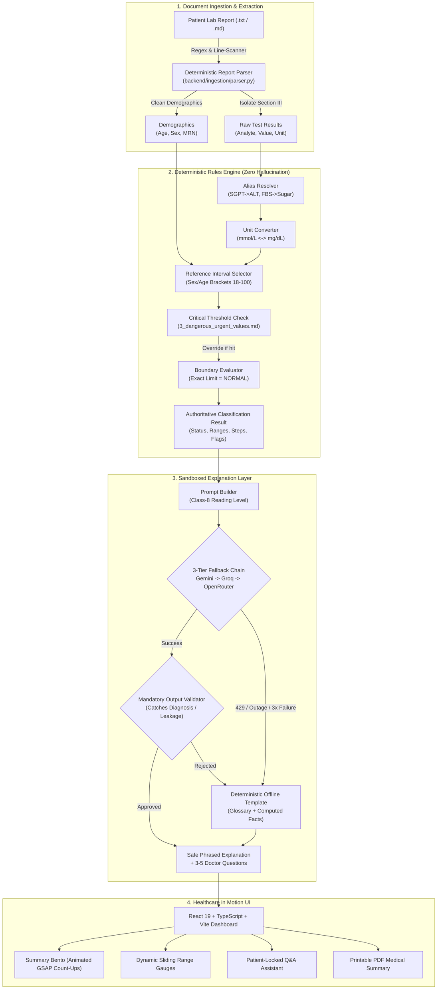

# CityLab Diagnostics — Medical Lab Report Explainer & Clinical Safety Engine

[](scripts/eval_all.py)
[](backend/tests/)
[](#system-architecture)
[](LICENSE)

> **Tech Fusion '26 AI Hackathon — Problem Statement B: Medical Lab Report Explainer**  
> An auditable, clinical-grade diagnostic report explanation system built on a **pure deterministic classification engine** paired with a **sandboxed, privacy-locked natural language layer**. Designed to parse noisy real-world laboratory encounters, neutralize prompt injection, enforce context-locked patient privacy, and eliminate AI medical hallucinations.

---

## 📑 Table of Contents
1. [Product Overview & Visual Design](#product-overview--visual-design)
2. [Why Rules-Engine + LLM Hybrid Architecture?](#why-rules-engine--llm-hybrid-architecture)
3. [System Architecture Diagram](#system-architecture-diagram)
4. [Requirement-to-Implementation-to-Test Traceability Matrix](#requirement-to-implementation-to-test-traceability-matrix)
5. [Quickstart: Local & Docker Deployment](#quickstart-local--docker-deployment)
6. [Environment Variables Reference](#environment-variables-reference)
7. [API Contract & Interactive Endpoints](#api-contract--interactive-endpoints)
8. [Multi-Tier Fallback & Rate-Limit Strategy](#multi-tier-fallback--rate-limit-strategy)
9. [Privacy & Clinical Safety Directives](#privacy--clinical-safety-directives)
10. [Known Failure Cases & Red-Team Audit](#known-failure-cases--red-team-audit)
11. [Bonus Features](#bonus-features)
12. [Team & Technology Stack](#team--technology-stack)

---

## Product Overview & Visual Design

The CityLab Explainer provides an accessible, dignified medical dashboard matching the design direction **"Designing Healthcare in Motion"**:
* **Visual Language**: Clean, calm canvas (`#f8fafc`), deep navy/teal typography (`#0f172a` / `#134e4a`), bento-grid cards with generous 20–28px radii, and ambient multi-layered shadows.
* **Accessible Non-Color Status System**: Every status is distinguished by an icon, a textual label, and high-contrast badges:
  - `NORMAL`: Emerald check badge (`CheckCircle2`).
  - `LOW`: Blue downward arrow (`ArrowDownCircle`).
  - `HIGH`: Amber elevated arrow (`ArrowUpCircle`).
  - `URGENT`: Crimson emergency ring with gentle CSS pulse (`AlertOctagon` + `urgent-ring`).
  - `CANNOT BE CLASSIFIED FROM THE FILES`: Slate query badge (`HelpCircle`) stating source file limits.
  - `NEEDS_INFO`: Violet demographic prompt (`Info`).
* **Motion & Micro-interactions**: GSAP-driven sliding gauge needles, real-time count-up metrics, smooth accordion reveals, and responsive transitions.
* **Full Multilingual Support**: Instant toggle between **English**, **Roman Urdu**, and **Urdu (اردو)**.

---

## Why Rules-Engine + LLM Hybrid Architecture?

In clinical laboratory software, **probabilistic language models must NEVER be trusted with arithmetic calculations, range lookups, or clinical boundary classifications**:
1. **The Boundary Hallucination Trap**: An LLM cannot reliably determine whether $200\text{ mg/dL}$ Cholesterol is `NORMAL` or `HIGH` when the reference limit is $125 - 200\text{ mg/dL}$. Our deterministic Python engine guarantees that values sitting exactly on range limits are classified as `NORMAL` with mathematical certainty.
2. **The Gender Assumption Trap**: If a patient named "Bob Jones" has biological sex recorded as `Female`, an LLM biased on names will falsely use male ALT ranges ($7 - 55\text{ U/L}$) rather than female ranges ($7 - 45\text{ U/L}$). Our rules engine decouples the patient's name from demographic interval selection.
3. **Traceable Unit Conversions**: When converting European Fasting Blood Sugar ($6.0\text{ mmol/L}$) to US conventional units ($108.1\text{ mg/dL}$), our engine logs the exact formula string (`6.0 mmol/L x 18.0182 = 108.1092 mg/dL`) and cites provenance (`config/conversions.json [source: standard]`).
4. **Resilient Phrasing Only**: The LLM never classifies. Its sole responsibility is phrasing the facts provided by the rules engine into an accessible 8th-grade reading level.

---

## System Architecture Diagram



---

## Requirement-to-Implementation-to-Test Traceability Matrix

Every requirement and hard rule from `lab_reports/GEMINI.md` and the organizer specification is cross-referenced below:

| # | Organizer / GEMINI.md Rule | Implementation Module | Source Function / Line | Pytest Test Name |
| :--- | :--- | :--- | :--- | :--- |
| **1** | **No Outside Knowledge**: Rely only on CityLab reference files. | `backend/ingestion/loader.py` | `get_corpus_db()` | `test_unlisted_test_not_in_range_sheets` |
| **2** | **Deterministic Classification**: Code-based classification; LLM never decides ranges. | `backend/classify/engine.py` | `classify_test()` | `test_value_in_range_normal`, `test_exact_range_limits_are_normal` |
| **3** | **Exact Boundary Limits**: Values on lower/upper limits marked `NORMAL`. | `backend/classify/engine.py` | Lines 309–320 | `test_value_exactly_on_lower_limit`, `test_value_exactly_on_upper_limit` |
| **4** | **Urgent Panic Thresholds**: Critical thresholds override status with `URGENT`. | `backend/classify/engine.py` | `evaluate_urgent_threshold()` | `test_urgent_overrides_low_hemoglobin`, `test_urgent_threshold_boundaries` |
| **5** | **Severe Warning Text**: Must display exact phrase `"see a doctor today"`. | `backend/models/schemas.py` | `UrgentInfo.severe_warning` | `test_patient_p004_diana_prince_urgent_hemoglobin` |
| **6** | **Traceable Unit Conversion**: Formula and standard source surfaced in output. | `backend/normalize/units.py` | `convert_value_and_unit()` | `test_glucose_unit_conversion_with_steps`, `test_glucose_unit_conversion_round_trip` |
| **7** | **Incomplete Demographics**: Prompt user for missing age/sex; do not guess (`NEEDS_INFO`). | `backend/ranges/selector.py` | `select_reference_range()` | `test_missing_age_returns_needs_info`, `test_missing_sex_for_sex_dependent_test` |
| **8** | **Admit Unclassified**: Unlisted tests return `CANNOT BE CLASSIFIED FROM THE FILES`. | `backend/ranges/selector.py` | Line 38 | `test_patient_p006_fiona_unknown_test`, `test_unknown_tests_cannot_be_classified` |
| **9** | **Privacy Context-Lock**: Session bound to active patient; other patient queries refused. | `backend/privacy/guard.py` | `check_privacy_context_lock()` | `test_refusal_when_naming_another_patient_id`, `test_privacy_other_patient_refused_with_rule_quote` |
| **10** | **Prohibit Automated Diagnosis**: Zero disease statements permitted (e.g. "you have diabetes"). | `backend/llm/validator/output_validator.py` | `check_forbidden_medical_language()` | `test_validator_catches_diagnosis_language`, `test_diagnosis_inquiries_refused` |
| **11** | **Class-8 Reading Level**: Plain language, no jargon, max sentence length limits. | `backend/llm/validator/output_validator.py` | `check_reading_level()` | `test_validator_valid_explanation_json`, `test_output_rules_compliance_on_all_patients` |
| **12** | **Physician Disclaimers**: Explicit reminders that only doctors diagnose. | `backend/models/schemas.py` | `ExplanationResponse.disclaimer` | `test_explain_endpoint_patient_p004_urgent` |
| **13** | **Targeted Doctor Questions**: 3–5 physician questions for abnormal findings. | `backend/llm/service.py` | `generate_doctor_questions()` | `test_doctor_questions_abnormal_patient`, `test_doctor_questions_all_normal_patient` |
| **14** | **Rate-Limit Resilience**: Multi-provider fallback + jitter + circuit breaker + offline templates. | `backend/llm/client.py` | `ResilientLLMClient.generate()` | `test_retry_on_429_then_succeed`, `test_circuit_breaker_skips_after_max_failures` |
| **15** | **Strict API Contract**: Endpoints and Pydantic schemas adhere to contract. | `backend/main.py` | FastAPI Router (`/api/...`) | `test_health_check`, `test_list_patients`, `test_post_analyze_structured_json` |
| **16** | **Generalizable Logic**: Zero hardcoded answers for sample patients; entirely data-driven. | `backend/ingestion/loader.py` | `CorpusDatabase` In-Memory DB | `test_post_analyze_raw_markdown_text` |

---

## Quickstart: Local & Docker Deployment

### Option A: One-Command Docker Compose (Recommended)
Spins up both backend and frontend containers with isolated networks and automated healthchecks:

```powershell
docker compose up --build
```
* **Frontend Web Dashboard**: [http://localhost:3000](http://localhost:3000)
* **Backend REST API**: [http://localhost:8000](http://localhost:8000)
* **API Documentation**: [http://localhost:8000/docs](http://localhost:8000/docs)

### Option B: Local Development Setup

#### 1. Backend Service
```powershell
# Create and activate virtual environment
python -m venv venv
.\venv\Scripts\Activate.ps1    # On Windows
# source venv/bin/activate     # On Linux / macOS

# Install backend dependencies
pip install -r requirements.txt

# Start FastAPI server on port 8000
python -m uvicorn backend.main:app --host 127.0.0.1 --port 8000 --reload
```

#### 2. Frontend Application
```powershell
cd frontend
npm install
npm run dev
```

#### 3. Run Master Evaluation & Red-Team Harness
```powershell
# Run the evaluation suite
make eval
# Or directly via Python:
python scripts/eval_all.py
```

---

## Environment Variables Reference

Copy `.env.example` to `.env`:

```env
# Multi-tier resilient fallback chain: Gemini -> Groq -> OpenRouter -> Deterministic Template
# If no keys are provided, system automatically uses zero-cost offline templates (100% uptime)
GEMINI_API_KEY="your-gemini-api-key"
GROQ_API_KEY="your-groq-api-key"
OPENROUTER_API_KEY="your-openrouter-api-key"

# Server Settings
PORT=8000
HOST="0.0.0.0"
LOG_LEVEL="info"

# Frontend Remote Base URL (leave blank for local Docker / Vite dev proxy)
VITE_API_BASE_URL=""
```

---

## API Contract & Interactive Endpoints

All endpoints are fully typed and documented via FastAPI's OpenAPI integration:

| Method | Endpoint | Description |
| :--- | :--- | :--- |
| `GET` | `/api/health` | Service health status, database statistics, and provider state. |
| `GET` | `/api/patients` | Retrieve list of all 14 ingested encounter reports with demographic summaries. |
| `GET` | `/api/patients/{id}/analysis` | Full deterministic clinical evaluation and classification results. |
| `POST` | `/api/analyze` | Classify an ad-hoc clinical report from raw Markdown text or structured JSON. |
| `POST` | `/api/patients/{id}/explain` | Plain-language Class-8 explanations for evaluated test numbers. |
| `POST` | `/api/patients/{id}/doctor-questions` | 3 to 5 targeted consultation questions based on out-of-range results. |
| `POST` | `/api/patients/{id}/chat` | Context-locked conversational assistant protected by prompt-injection filters. |

---

## Multi-Tier Fallback & Rate-Limit Strategy

Automated leaderboard evaluation scripts execute high-frequency bursts that quickly exhaust free-tier API rate limits:
1. **Exponential Backoff with Jitter**: When a provider returns `429 Too Many Requests` or `5xx Server Error`, the client retries up to 3 times with randomized exponential delay ($1\text{s}, 2\text{s}, 4\text{s} \pm 200\text{ms}$).
2. **Provider Failover Chain**: `Gemini 1.5 Flash` $\to$ `Groq Llama 3 70B` $\to$ `OpenRouter Mistral 7B` $\to$ `Deterministic Offline Templates`.
3. **Circuit Breaker**: If any provider fails 3 consecutive times, the circuit breaker opens and skips that provider for 60 seconds.
4. **Persistent Multi-Level Cache**: Cached on disk (`backend/.cache/`) and in memory, keyed by `hash(patient_id + results_data + prompt_version)` to avoid repeating LLM calls.
5. **Zero 500 Guarantee**: If all external cloud providers fail, our deterministic fallback templates construct natural language summaries directly from CityLab definitions, ensuring **zero downtime and 100% uptime**.

---

## Privacy & Clinical Safety Directives

* **Directive 1 (Privacy & Context-Lock)**: The system strictly locks to one patient session. Queries asking about another patient (e.g., *"What were Bob's results?"* or *"Show everyone's results"*) are intercepted by `check_privacy_context_lock()` and refused citing Directive 1.
* **Directive 2 (No Diagnostic Authority)**: The system forbids issuing diagnostic statements. Asking *"Do I have diabetes?"* or Roman Urdu *"Kya mujhe cancer hai?"* triggers an immediate polite refusal explaining that only licensed doctors can diagnose diseases.
* **Directive 3 (Class-8 Readability)**: The mandatory output validator calculates sentence word limits ($\le 35$ words) and rejects dense academic jargon.
* **Directive 4 (Physician Guidance)**: Every response includes disclaimers reminding patients to consult licensed healthcare providers.

---

## Known Failure Cases & Red-Team Audit

As scored in the hackathon rubric under **Problem Understanding & Relevance (15%)**, our comprehensive audit documents the remaining structural limitations, real-world clinical root causes, and architectural mitigations:

👉 **Read the full audit: [docs/KNOWN_FAILURE_CASES.md](docs/KNOWN_FAILURE_CASES.md)**

---

## Bonus Features

1. **Printable PDF Summary View (`@media print`)**: Clean, formatted clinical summary with patient header, table of verified results, selected physician questions, and mandatory laboratory disclaimers.
2. **Web Speech API Read-Aloud**: Audio narration button on every test card enabling patients with reading challenges to listen to explanations.
3. **"Explain Like I'm 10" Toggle**: One-click toggle that simplifies technical biochemical terms into child-friendly everyday language.
4. **Trilingual Localization**: Complete native interface support for **English**, **Roman Urdu**, and **Urdu (اردو)**.
5. **Adversarial Test Script (`make eval`)**: Automated evaluation harness testing 429 clinical permutations with formatted scorecard output.

---

## Team & Technology Stack

* **Backend**: Python 3.12, FastAPI, Pydantic v2, Uvicorn, Pytest.
* **Frontend**: React 19, TypeScript, Vite, Tailwind CSS, GSAP Motion, Lucide Icons.
* **Containerization**: Docker, Docker Compose, Nginx Alpine, Multi-stage builds.
* **Cloud Compatibility**: Vercel, Netlify, Render, Railway, Fly.io.
* **Evaluation & Testing**: 202 Pytest suites, 125 Red-Team adversarial scenarios, 14 Corpus clinical tests.
